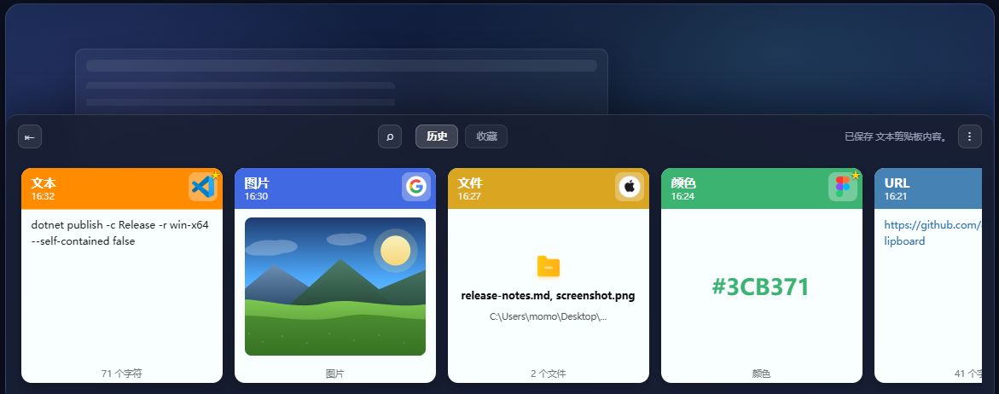

# OpenClipboard

**English** | [简体中文](README.md)

**Your clipboard history, always within reach.**

OpenClipboard is a lightweight, open-source clipboard history manager. Summon a full-width panel from the bottom of your desktop with a global hotkey, browse text, images, and files as horizontal cards, and quickly search, favorite, and reuse anything you copied — with source-app icons and local-first privacy.

[Website](https://www.openclipboard.cc.cd) · [Download](https://github.com/gzymomo/openclipboard/releases) · [Feedback](https://github.com/gzymomo/openclipboard/issues)

[](https://github.com/gzymomo/openclipboard/actions/workflows/win.yml)
[](https://github.com/gzymomo/openclipboard/actions/workflows/linux.yml)
[](https://github.com/gzymomo/openclipboard/actions/workflows/macos.yml)
[](LICENSE)

---

## Why OpenClipboard

- **Instant access, no workflow interruption**: Press a global hotkey (default `F2`) to bring up a fixed, full-width panel from the bottom of the screen without breaking your focus
- **History at a glance**: Browse clipboard entries as a horizontal card list in chronological order; double-click any card to copy it back
- **Clear content previews**: Type-aware cards and previews for text, images, files, colors, URLs, JSON, XML, Markdown, and more (including JSON/XML highlighting and Markdown rendering)
- **Know where it came from**: Shows the source app name and icon when available (best support on Windows/macOS, best-effort on Linux X11, graceful fallback on Wayland)
- **Local-first privacy**: Data is stored locally in SQLite — no cloud sync required — with configurable retention, cleanup, and favorites behavior
- **Cross-platform**: Available for Windows, macOS, and Linux (x64 / ARM64)

> Preview and demo: **https://www.openclipboard.cc.cd**



## Key Features

- **Multi-type clipboard history**: Automatically records text, images, and files (plus recognized types such as colors, URLs, JSON, XML, and Markdown)
- **Horizontal card panel**: Fixed full-width panel docked to the bottom of the desktop with type-colored headers, source icons, favorite markers, and content previews
- **Search and favorites**: Quickly filter history and pin frequently used items (favorites can be preserved from retention cleanup)
- **Efficient actions**: Double-click to copy, multi-select and context menu actions (copy/favorite/delete), and jump to the latest entry
- **System integration**: Tray icon, global hotkey, and launch-at-login support (depending on platform capabilities)
- **Personalization**: Multi-language UI, customizable activation/quick-copy hotkeys, history retention period, transparency/glass effects, scroll speed, and more
- **Data management**: Local SQLite storage, clear history, and import from the legacy Windows database

## Download & Run

Download prebuilt packages for your platform (Windows / macOS / Linux, x64 / ARM64) from [**GitHub Releases**](https://github.com/gzymomo/openclipboard/releases).

- **Cross-platform edition (recommended, actively maintained)**: `OpenClipboard.App` (.NET 10 + Avalonia)
  - **Windows**: Distributed as self-contained `.zip` and `.exe` installer packages (x64 / ARM64) — **no .NET runtime installation required**; extract and run, or install with the setup wizard
  - **Linux**: Distributed as self-contained `.deb` packages (amd64 / arm64) — **no .NET runtime installation required**; install with `dpkg`
  - **macOS**: Distributed as a self-contained `.dmg` (containing `OpenClipboard.app`) — **no .NET runtime installation required**; double-click to mount, then drag into Applications
- **Windows classic edition (WPF, less actively maintained)**: `Clipboard.Desktop` (.NET Framework 4.7.2)
  - Usually preinstalled on Windows 10/11; on older systems you may need to install [.NET Framework 4.7.2+](https://dotnet.microsoft.com/download/dotnet-framework)

### Usage Notes

- After launch, OpenClipboard stays in the system tray by default. Press `F2` (customizable in settings) to open the panel.
- Global hotkey availability depends on OS permissions and desktop environment: on macOS, grant the required privacy permissions (such as Input Monitoring and/or Accessibility) as needed. On Linux Wayland, the global hook needs raw input access: the `.deb` package creates a dedicated `openclipboard` system group and a udev rule that grants **only this app** read access to `/dev/input/event*` (**log out and back in once** after installing). This means the app can read all keyboard input — please be aware; the tray icon remains available if you prefer not to grant it. Source-app detection is still degraded on Wayland.
- On Linux, the portable `.zip` build has no such grant, so global hotkeys do not work on Wayland sessions (Xorg is unaffected); use the tray icon to open the panel instead.
- macOS packages are ad-hoc signed and not notarized. After dragging the app out of the dmg, if macOS reports that the developer cannot be verified, run:
  ```sh
  xattr -dr com.apple.quarantine /Applications/OpenClipboard.app
  ```
- Cross-platform data location: `OpenClipboard/cross-platform.db` under each platform's application data directory (separate from the legacy WPF database; legacy data can be imported).

## Build from Source

### Cross-platform edition (.NET 10)

```sh
dotnet build src/OpenClipboard.CrossPlatform.slnx -c Release
dotnet run --project src/OpenClipboard.App/OpenClipboard.App.csproj
```

Publish example (Windows x64, self-contained):

```sh
dotnet publish src/OpenClipboard.App/OpenClipboard.App.csproj -c Release -r win-x64 --self-contained true
```

Linux uses self-contained publish and packages a `.deb` (requires `dpkg-deb`):

```sh
dotnet publish src/OpenClipboard.App/OpenClipboard.App.csproj -c Release -r linux-x64 --self-contained true
chmod +x installer/linux/package-deb.sh
installer/linux/package-deb.sh \
  src/OpenClipboard.App/bin/Release/net10.0/linux-x64/publish \
  1.1.7 amd64 artifacts/openclipboard_1.1.7_amd64.deb
```

macOS uses a separate self-contained packaging flow that produces a `.dmg` containing a launchable `OpenClipboard.app`:

```sh
dotnet publish src/OpenClipboard.App/OpenClipboard.App.csproj -c Release -r osx-x64 \
  --self-contained true
installer/macos/package.sh \
  src/OpenClipboard.App/bin/Release/net10.0/osx-x64/publish \
  1.1.7 artifacts/OpenClipboard-osx-x64-1.1.7.dmg
```

> Do **not** override the assembly name globally with `-p:AssemblyName=OpenClipboard`, as it applies to all `ProjectReference`s and causes `Ambiguous project name`. `package.sh` only renames the apphost inside the bundle to `OpenClipboard`, while the assembly name and `avares://OpenClipboard.App/...` resource URIs remain unchanged.
>
> Renaming the apphost is safe because the host still resolves `OpenClipboard.App.dll` internally. However, macOS treats executables ending in `.App` as application bundles, and Gatekeeper may terminate the process.

### Windows classic edition (WPF)

```powershell
.\build.ps1                    # Build and package
.\build-installer.ps1          # Generate installer (NSIS)
```

## Project Structure

```text
src/
  OpenClipboard.App/             # Cross-platform Avalonia app (net10.0, recommended)
  OpenClipboard.App.Tests/       # Cross-platform tests
  OpenClipboard.CrossPlatform.slnx
  Clipboard.Desktop/             # Windows classic WPF app (net472)
  Clipboard.Data/                # Data models and enums
docs/                            # Website / landing page source (GitHub Pages)
.github/workflows/               # CI (triggered on version tags or manually)
```

## Privacy & Notes

- Clipboard history is stored locally in a SQLite database by default and is not uploaded to the cloud
- Configure retention and cleanup policies according to your needs, especially on shared or sensitive environments
- Source-app detection, hotkeys, and visual effects depend on OS permissions and desktop environment capabilities; some features degrade gracefully when unavailable

## License & Disclaimer

- Open source under the [MIT License](LICENSE)
- Reconstructed from decompiled artifacts for learning, research, and interoperability purposes only; not affiliated with any original software vendor and does not include their trademarks or branding
- Please verify your rights and comply with local laws before use or distribution; the software is provided "as is", without warranty of any kind

---

**Website:** https://www.openclipboard.cc.cd  
**Download:** https://github.com/gzymomo/openclipboard/releases
