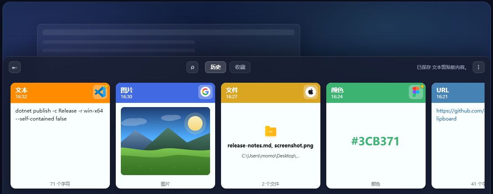

# OpenClipboard

**你的剪贴板历史，随取随用。**

一款轻量、开源的剪贴板历史管理器。全局热键从桌面底部呼出全宽面板，横向卡片记录文本、图片、文件等内容，支持搜索、收藏、来源应用图标识别与本地隐私存储，让每一次复制都可追溯、可复用。

[官网](https://www.openclipboard.cc.cd) · [下载最新版](https://github.com/gzymomo/openclipboard/releases) · [反馈建议](https://github.com/gzymomo/openclipboard/issues)

[](https://github.com/gzymomo/openclipboard/actions/workflows/cross-platform.yml)
[](LICENSE)

---

## 为什么选择 OpenClipboard

- **随手唤起，不卡工作流**：全局热键（默认 `F2`）从桌面底部呼出固定全宽面板，不打断当前操作
- **历史一目了然**：横向卡片列表按时间展示，双击即可复制回剪贴板
- **内容类型更清晰**：文本、图片、文件、颜色、URL、JSON、XML、Markdown 等类型化卡片与预览（含 JSON/XML 高亮、Markdown 渲染）
- **知道“从哪复制的”**：记录来源应用名称与图标（Windows/macOS 优先支持，Linux X11 尽力识别，Wayland 自动降级）
- **本地优先，隐私可控**：数据存储在本地 SQLite，不依赖云同步，可配置保留期限、清理与收藏策略
- **跨平台可用**：支持 Windows、macOS、Linux（x64 / ARM64）

> 预览与功能演示：**https://www.openclipboard.cc.cd**



## 核心功能

- **多类型剪贴板历史**：自动记录文本、图片、文件（及颜色/URL/JSON/XML/Markdown 等识别类型）
- **横向卡片面板**：桌面底部全宽、固定尺寸面板；类型着色卡片头、来源图标、收藏标记与内容预览
- **搜索与收藏**：快速筛选历史，收藏常用条目（收藏项可不受过期清理影响）
- **高效操作**：双击复制、多选与右键菜单（复制/收藏/删除）、一键跳转最新
- **系统集成**：托盘驻留、全局热键、开机自启（按平台能力支持）
- **个性化设置**：多语言界面、激活/快速复制热键、历史保留期限、透明度/毛玻璃效果、滚轮速度等
- **数据管理**：本地 SQLite 存储、清空历史、支持从旧版 Windows 数据库导入

## 下载与运行

前往 [**GitHub Releases**](https://github.com/gzymomo/openclipboard/releases) 下载对应平台的预编译包（Windows / macOS / Linux，x64 / ARM64）。

- **跨平台版（推荐，活跃维护）**：`OpenClipboard.App`（.NET 10 + Avalonia）
  - 当前发布产物为 **框架依赖（framework-dependent）** 构建，运行前需安装 [.NET 10 Runtime](https://dotnet.microsoft.com/download/dotnet/10.0)
- **Windows 经典版（WPF，维护较少）**：`Clipboard.Desktop`（.NET Framework 4.7.2）
  - Windows 10/11 通常已自带所需 .NET Framework；旧系统可能需安装 [.NET Framework 4.7.2+](https://dotnet.microsoft.com/download/dotnet-framework)

### 使用提示
- 启动后默认驻留托盘，按 `F2`（可在设置中修改）呼出面板
- 全局热键可用性受系统权限/桌面环境影响：macOS 需辅助功能权限；Linux Wayland 环境下热键或来源识别可能受限，仍可通过托盘使用
- 跨平台版数据目录：各平台应用数据目录下 `OpenClipboard/cross-platform.db`（与旧版 WPF 数据库分开，可在设置/功能中导入旧库）

## 从源码构建

### 跨平台版（.NET 10）

```sh
dotnet build src/OpenClipboard.CrossPlatform.slnx -c Release
dotnet run --project src/OpenClipboard.App/OpenClipboard.App.csproj
```

发布示例（Windows x64，框架依赖）：

```sh
dotnet publish src/OpenClipboard.App/OpenClipboard.App.csproj -c Release -r win-x64 --self-contained false
```

> 如需用户无需预装运行时，可使用 `--self-contained true`（或评估 Native AOT）按目标平台单独发布，产物体积会相应增加。

### Windows 经典版（WPF）

```powershell
.\build.ps1                    # 构建并打包
.\build-installer.ps1          # 生成安装包（NSIS）
```

## 项目结构

```text
src/
  OpenClipboard.App/             # 跨平台 Avalonia 主程序（net10.0，推荐）
  OpenClipboard.App.Tests/       # 跨平台测试
  OpenClipboard.CrossPlatform.slnx
  Clipboard.Desktop/             # Windows WPF 经典版（net472）
  Clipboard.Data/                # 数据模型与枚举
docs/                            # 官网/宣传页源码（GitHub Pages）
.github/workflows/               # CI（版本 tag 或手动触发）
```

## 隐私与说明

- 剪贴板历史默认仅保存在本地 SQLite 数据库，不上传云端
- 请在共享设备或敏感环境中结合自身需求配置保留与清理策略
- 来源应用识别、热键、透明效果等能力受操作系统权限与桌面环境限制，部分场景会自动降级

## 许可证与免责声明

- 本项目基于 [MIT License](LICENSE) 开源
- 本项目由反编译产物整理、重建而来，仅用于学习、研究与互操作性目的；与任何原软件厂商无关，也不包含其商标或品牌信息
- 请在使用、分发前自行确认你拥有相应权利并遵守当地法律；软件按“现状”提供，不附带任何明示或暗示担保

---

**官网：** https://www.openclipboard.cc.cd  
**下载：** https://github.com/gzymomo/openclipboard/releases
